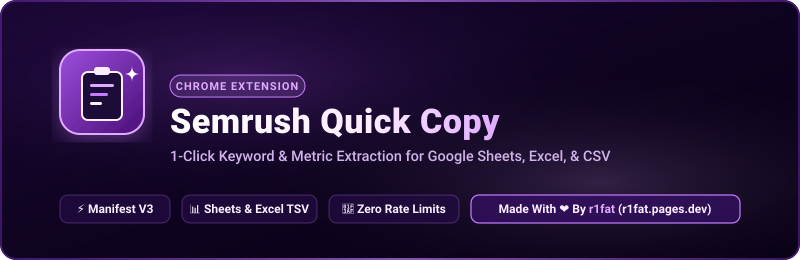

<div align="center">



# Semrush Quick Copy

**Instant 1-click keyword & metric extraction from Semrush Keyword Magic Tool.**  
Export clean, color-styled tabular data directly into Google Sheets, Excel, or CSV with zero manual copying.

[](CHANGELOG.md)
[](https://developer.chrome.com/docs/extensions/mv3/)
[](LICENSE)
[](https://r1fat.pages.dev)

</div>

---

### About The Project

**Semrush Quick Copy** was built to eliminate the tedious friction in daily SEO keyword research and KGR analysis. 

When working on a free Semrush account, users are limited to **10 searches per day**, and each search displays only the **top 10 keywords** (with subsequent rows blurred behind a paywall). Because native bulk export features are gated behind paid subscriptions, researchers and marketers are forced to manually highlight, copy, and clean entries cell-by-cell.

This extension solves that problem directly inside the browser:
- **No Google Apps Script required.**
- **No external API keys or OAuth setups.**
- Uses modern **Rich Clipboard (`text/html` + `text/plain`)** injection, so pressing `Ctrl + V` in Google Sheets or Excel pastes a **fully color-formatted table** with bold deep-purple headers, intent badges, Keyword Difficulty (KD%) heatmap coloring, and live **KGR (Keyword Golden Ratio)** formula calculations!

---

### Spreadsheet Format

The copied table follows the optimal SEO research structure:

| Column | Header | Description |
| :---: | :--- | :--- |
| **A** | **Keyword** | The search phrase |
| **B** | **Intent** | Color-coded badge (Informational, Commercial, etc.) |
| **C** | **MSV** | Monthly Search Volume (numeric for formula calculation) |
| **D** | **KD %** | Semrush difficulty with dynamic heatmap coloring |
| **E** | **ALLINTITLE** | Cached count OR 1-click Google search hyperlink |
| **F** | **KGR** | Live formula `=IF(AND(E2<>"", C2>0), ROUND(IF(ISNUMBER(E2), E2, VALUE(SUBSTITUTE(E2, ",", ""))) / C2, 4), "")` |
| **G** | **CPC** | Cost Per Click ($) |
| **H** | **Comp. Density** | Competitive density score |
| **I** | **Freshness** | Data recency (e.g. 1 month) |

---

### Codebase Architecture

```
semrush-quick-copy/
├── src/
│   ├── shared/                # Common domain logic & state
│   │   ├── colors.js          # Intent, KD%, and KGR palettes
│   │   ├── formatters.js      # Multi-format table builders & formula engine
│   │   └── storage.js         # Chrome storage wrapper & key pruner
│   ├── content/               # In-page Semrush injection
│   │   ├── scraper.js         # DOM table parser & master header filters
│   │   ├── kgr-runner.js      # Throttled background Google SERP runner
│   │   ├── widget-ui.js       # Shadow DOM floating widget
│   │   ├── index.js           # Content script entry & observer
│   │   └── styles/            # Content host styles
│   ├── google/                # Google SERP injection
│   │   └── grabber.js         # allintitle result-stats extractor
│   └── popup/                 # Extension toolbar popup
│       ├── popup.html         # Popup structure
│       ├── styles/            # Popup CSS theme
│       └── scripts/           # UI renderer & controller
├── assets/                    # Visual branding & extension icons
│   ├── banner.svg
│   └── icons/
├── manifest.json              # Chrome MV3 manifest
└── package.json
```

---

### Key Features

- **⚡ Google Search allintitle Auto-Grabber**: Automatically catches result counts from Google (`#result-stats`) when searching `allintitle:...` and saves them to local storage.
- **🎯 1-Click "Auto-Check KGR"**: Single button in popup and on-page widget that sequentially fetches `allintitle` result counts for all 10 keywords.
- **🎨 Direct Colored Google Sheets / Excel Paste**:
  - **Deep Purple Header**: `#2B0F52` background with crisp white typography.
  - **KD% Heatmap Coloring**: Automatically colors KD cells (Green = Very Easy, Yellow = Possible, Orange = Difficult, Red = Hard).
  - **KGR Heatmap**: Green (<0.25 = ⭐ Golden), Yellow (0.25 - 1.00 = ⚡ Moderate), Red (>1.00 = ⛔ Hard).
  - **Intent Badges**: Soft color-coded tags for Informational, Commercial, Transactional, and Navigational intents.
- **💾 1-Click CSV File Download**: Direct `.csv` export with UTF-8 BOM encoding for Excel.
- **⚡ Dual Access**:
  - **Shadow DOM Floating Widget**: Encapsulated bottom-right pill with zero CSS leakage from Semrush.
  - **Extension Toolbar Popup**: Full card preview with live metrics and count badges.

---

### Quick Installation

1. **Clone or Download** this repository:
   ```bash
   git clone https://github.com/rifatlovescat/semrush-copy-extension.git
   ```
   *(Or download as a ZIP and extract the folder)*.

2. Open Google Chrome and go to:
   ```
   chrome://extensions/
   ```

3. Enable **Developer mode** using the toggle switch in the top-right corner.

4. Click the **Load unpacked** button in the top-left corner.

5. Select the `SemRush Copy Extension` directory.

---

### Usage

1. Open [Semrush Keyword Magic Tool](https://www.semrush.com/analytics/keywordmagic/) or any keyword search.
2. Search for any term (e.g. `penguin`).
3. Click either:
   - The on-page widget: **"Copy for Sheets (KGR)"**, OR
   - **"Download CSV"** to save a clean `.csv` file, OR
   - The extension icon in your toolbar.
4. Go to Google Sheets or Excel and press **`Ctrl + V`** (or `Cmd + V`).
5. Your spreadsheet is instantly filled with color-coded, formatted data!

---

### Releases & Versioning

Detailed release history and changelogs are maintained in [CHANGELOG.md](CHANGELOG.md).

- **[v1.3.0](https://github.com/rifatlovescat/semrush-copy-extension/releases/tag/v1.3.0)** - *Complete modular architecture, dedicated subfolders, codebase hygiene, and clutter deletion.*
- **[v1.2.2](https://github.com/rifatlovescat/semrush-copy-extension/releases/tag/v1.2.2)** - *Direct 1-click CSV file download with UTF-8 BOM.*
- **[v1.2.1](https://github.com/rifatlovescat/semrush-copy-extension/releases/tag/v1.2.1)** - *Filtered out master table header row and robust KGR zero-division guard.*
- **[v1.2.0](https://github.com/rifatlovescat/semrush-copy-extension/releases/tag/v1.2.0)** - *Keyword Golden Ratio (KGR) calculation, Google allintitle grabber, and Auto-Check button.*
- **[v1.1.0](https://github.com/rifatlovescat/semrush-copy-extension/releases/tag/v1.1.0)** - *Rich Colored Sheets Clipboard, Semrush KD% Heatmap, and Shadow DOM Widget Isolation.*
- **[v1.0.0](https://github.com/rifatlovescat/semrush-copy-extension/releases/tag/v1.0.0)** - *Initial release.*

---

### Tags & Topics

`#seo` `#semrush` `#chrome-extension` `#google-sheets` `#excel` `#keyword-research` `#data-extraction` `#growth-hacking` `#manifest-v3` `#productivity`

---

<div align="center">

### Fixed Footer & Attribution

**Made With ❤️ By <a href="https://r1fat.pages.dev" target="_blank">r1fat</a>**

*(Visit [r1fat.pages.dev](https://r1fat.pages.dev))*

</div>
